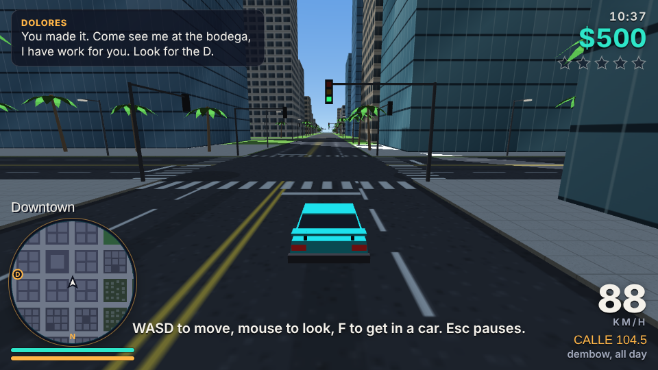
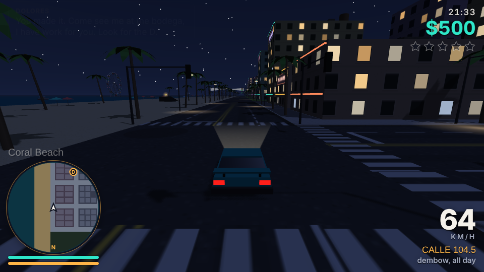

# Solano Heat

An original open-world crime sandbox that runs in the browser. Steal a ride, run jobs for Dolores at the corner bodega, and lose the cops before they lose patience.

Everything is generated in code: the city of Port Solano, the cars, the people, the textures and the three radio stations. The only dependency at runtime is [three.js](https://threejs.org/) r128, loaded from cdnjs.



## Play

Open `index.html` in a desktop or phone browser. No server or install is needed, but you do need an internet connection the first time so three.js and the fonts can load.

To host it, turn on GitHub Pages for this repo (Settings → Pages → deploy from the `main` branch, root folder) and open the URL it gives you.

Progress (money, finished jobs, tapes found) is saved in your browser's local storage.

## What's in the city

- **Port Solano**: a 10 × 10 block grid with downtown towers, Midtown, the Palmetto Heights suburbs, Bayfront Park, a port with container stacks and cranes, and Coral Beach with hotels, a pier, a Ferris wheel and a lighthouse.
- **Day and night**: a 12-minute day. Windows, neon signs, street lamps and headlights light up after sunset.
- **7 drivable cars**: Brisa hatchback, Marlin sedan, Solano Cab, Tarpon GT sports car, Pelican van, Gator pickup and the Patrol Cruiser. Arcade handling with drifting, damage, fire and explosions.
- **Traffic**: cars follow lanes, stop at traffic lights, yield on left turns and pull over for sirens. Pedestrians walk the sidewalks, cross on the signal and run from trouble.
- **Wanted level**: 1 to 5 stars. Police cars chase and box you in, officers get out and chase you on foot, and a helicopter joins at 4 stars. Break line of sight to lose them, or pay $100 at a Fresh Coat paint shop.
- **5 story missions** for Dolores, **10 hidden tapes**, **3 stunt ramps**, and a full map with waypoints.



## Controls

| Action | Keyboard and mouse | Gamepad |
| --- | --- | --- |
| Move / drive | W A S D or arrow keys | Left stick, triggers for gas and brake |
| Look | Mouse (click to lock the pointer) | Right stick |
| Get in or out of a car | F | Y |
| Run | Shift | B or left stick click |
| Jump / handbrake | Space | A |
| Punch | Click or J | X |
| Horn | H | Right stick click |
| Next radio station | Q | Bumpers |
| Camera distance | C | |
| Map | M | Back |
| Pause | Esc | Start |

On a phone, drag on the left half of the screen to move or steer, drag on the right half to look, and use the on-screen buttons for everything else.

## Project layout

```
shell.html        HTML, CSS and HUD markup (the build inserts the game code)
js/00_util.js     Math helpers and city constants
js/01_geo.js      Geometry builder and procedural textures
js/02_world.js    City generation, collision grid, ground heights, world animation
js/03_sky.js      Sky dome, sun, moon, stars, fog and the day/night cycle
js/04_vehicles.js Car models, driving physics and car-to-car collisions
js/05_traffic.js  Road graph, driver AI (traffic and police) and spawning
js/06_peds.js     People: models, sidewalk AI, fleeing and knockdowns
js/07_player.js   Player on foot and in cars
js/08_police.js   Wanted level, pursuit, arrests and the helicopter
js/09_missions.js Missions, collectibles, stunt jumps, paint shops and save data
js/10_audio.js    Engine, sirens, sound effects and the generative radio
js/11_fx.js       Particles: smoke, fire, sparks and explosions
js/12_input.js    Keyboard, mouse, touch and gamepad input
js/13_hud.js      HUD, minimap and full map
js/14_main.js     Game loop, camera, game events and boot
build.py          Bundles shell.html + js/ into index.html
tests/            Headless browser tests (Playwright)
```

## Build

The game code lives in `js/`. After editing it, rebuild `index.html`:

```sh
python3 build.py
```

This writes `index.html` (the playable page) and `dist/` (the bundle and a test page).

To lint the bundle:

```sh
npm install
npm run lint
```

## Tests

The tests drive the game in headless Chromium through a debug hook that is only active when the URL ends in `#debug`. They need Python with Playwright and the `three` package from `npm install`.

```sh
npm install
pip install playwright && python3 -m playwright install chromium
python3 build.py
cd tests
python3 f1_basics.py     # walking, jumping, entering cars, driving, braking
python3 f2_ramp.py       # stunt jump payout, crash damage, explosions
python3 f3_traffic.py    # traffic soak: lane keeping, stuck cars, collisions
python3 f7_arrest.py     # police pursuit, arrests in a car and on foot
python3 f8_missions.py   # runs through all five missions
python3 f9_extras.py     # tapes, paint shop, radio, map, pause
```

## Note

Solano Heat is an original game. It is not affiliated with or based on the assets of any existing game or studio. All names, places, vehicles and brands in it are made up.
